<a href="assets/hero-light.svg#gh-light-mode-only"></a><a href="assets/hero-dark.svg#gh-dark-mode-only"></a>

<samp>
<a href="https://apps.apple.com/jp/app/id6760934295">Stellise</a> ·
<a href="https://apps.apple.com/jp/app/voice-context/id6804673846">Voice Context</a> ·
<a href="https://github.com/Maaa2005/web-capability-compiler">WCC</a> ·
<a href="https://github.com/Maaa2005/aun-protocol">AUN</a> ·
<a href="https://www.npmjs.com/package/kasane-cli">KASANE</a> ·
<a href="https://x.com/llmcat17371">X</a>
</samp>

**AIと融合したい。** 聞いたことを一緒に聞き、知っていることを覚えていて、代わりに動いてくれるように。

名古屋の学生エンジニアです（2028年卒）。そのための部品として、身の回りの文脈を拾う **iOSアプリ** と、AIエージェントが安全に動くための **道具** を作っています。

<a href="assets/sections/numbers-light.png#gh-light-mode-only">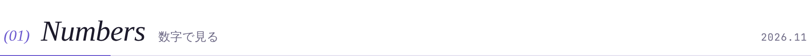</a><a href="assets/sections/numbers-dark.png#gh-dark-mode-only">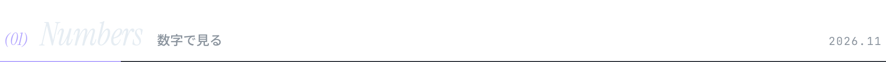</a>

<a href="assets/stats-light.png#gh-light-mode-only">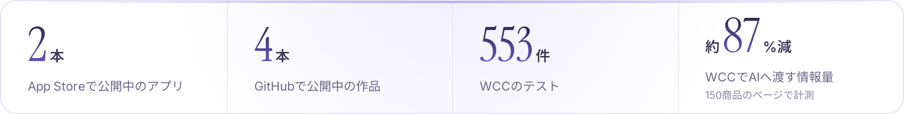</a><a href="assets/stats-dark.png#gh-dark-mode-only">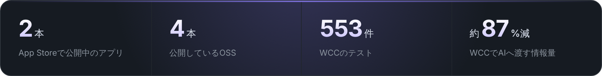</a>

<a href="assets/sections/apps-light.png#gh-light-mode-only">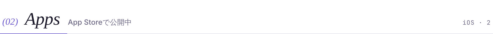</a><a href="assets/sections/apps-dark.png#gh-dark-mode-only">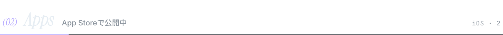</a>

<a href="https://apps.apple.com/jp/app/id6760934295#gh-light-mode-only"></a><a href="https://apps.apple.com/jp/app/id6760934295#gh-dark-mode-only"></a>

<a href="https://apps.apple.com/jp/app/voice-context/id6804673846#gh-light-mode-only"></a><a href="https://apps.apple.com/jp/app/voice-context/id6804673846#gh-dark-mode-only"></a>

<a href="assets/sections/oss-light.png#gh-light-mode-only">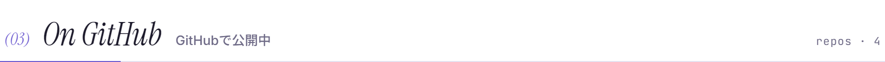</a><a href="assets/sections/oss-dark.png#gh-dark-mode-only">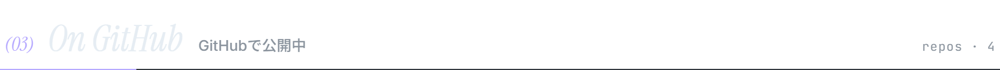</a>

<a href="https://github.com/Maaa2005/web-capability-compiler#gh-light-mode-only">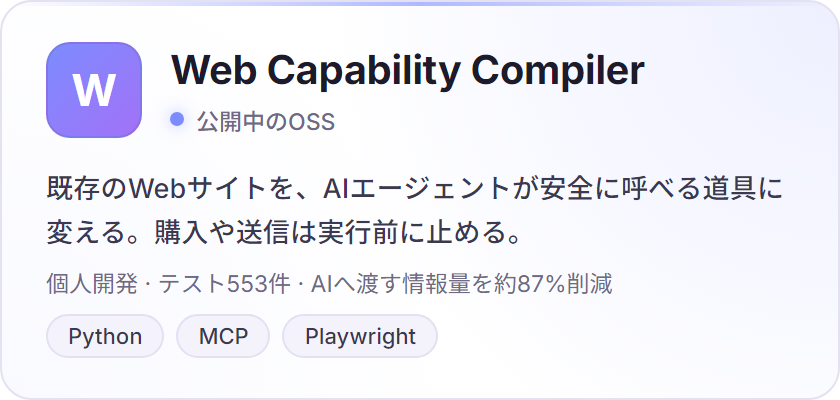</a><a href="https://github.com/Maaa2005/web-capability-compiler#gh-dark-mode-only">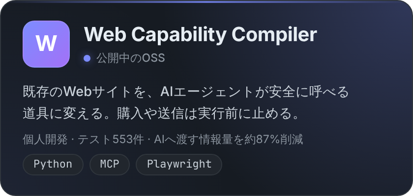</a>
<a href="https://github.com/Maaa2005/aun-protocol#gh-light-mode-only">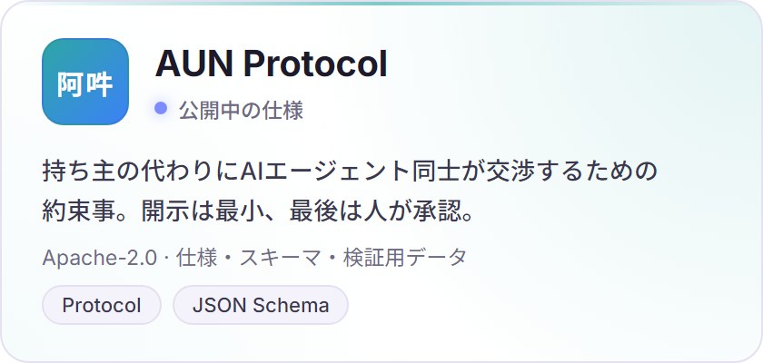</a><a href="https://github.com/Maaa2005/aun-protocol#gh-dark-mode-only">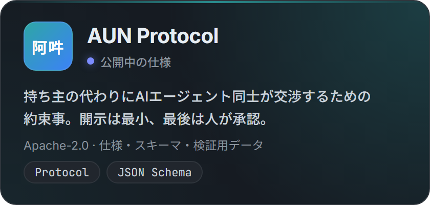</a>

<a href="https://github.com/Maaa2005/KASANE#gh-light-mode-only">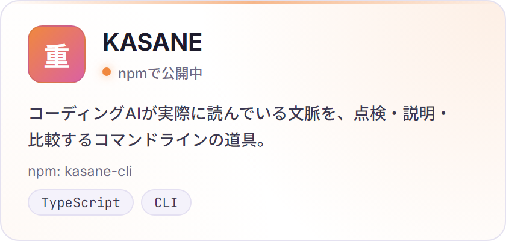</a><a href="https://github.com/Maaa2005/KASANE#gh-dark-mode-only">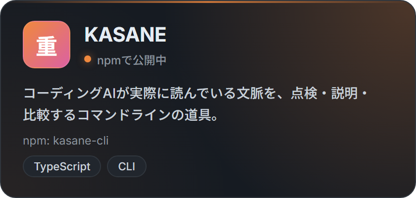</a>
<a href="https://github.com/Maaa2005/local-rag-agent#gh-light-mode-only">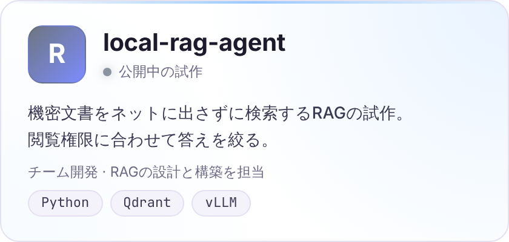</a><a href="https://github.com/Maaa2005/local-rag-agent#gh-dark-mode-only">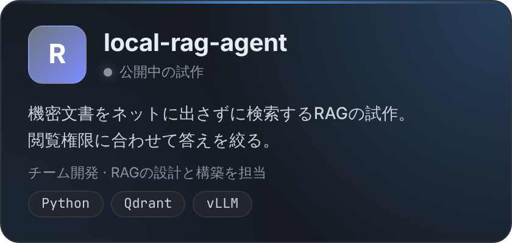</a>

<a href="assets/sections/principles-light.png#gh-light-mode-only">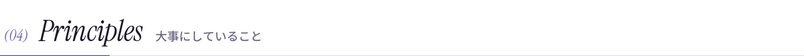</a><a href="assets/sections/principles-dark.png#gh-dark-mode-only">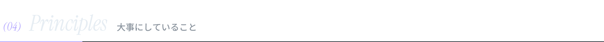</a>

<a href="assets/panels/principles-light.png#gh-light-mode-only">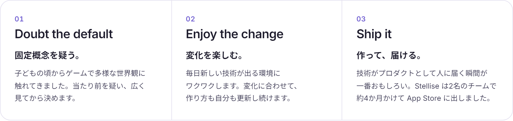</a><a href="assets/panels/principles-dark.png#gh-dark-mode-only">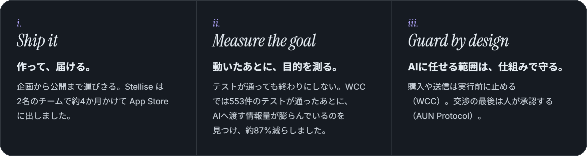</a>

<a href="assets/sections/timeline-light.png#gh-light-mode-only">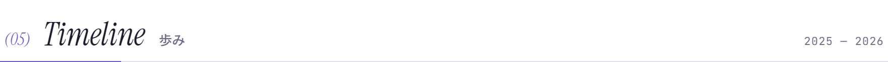</a><a href="assets/sections/timeline-dark.png#gh-dark-mode-only">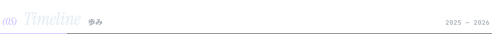</a>

<a href="assets/panels/timeline-light.png#gh-light-mode-only">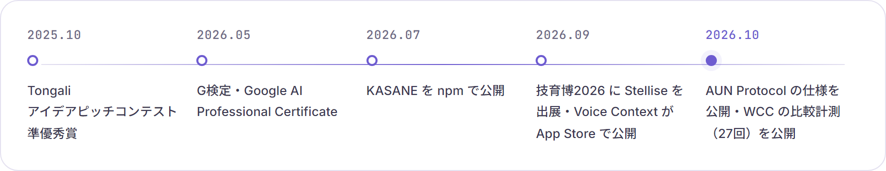</a><a href="assets/panels/timeline-dark.png#gh-dark-mode-only">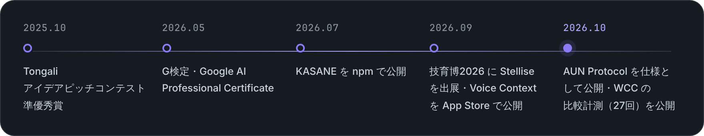</a>

<a href="assets/sections/activity-light.png#gh-light-mode-only">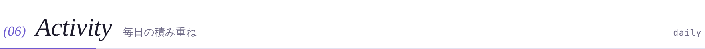</a><a href="assets/sections/activity-dark.png#gh-dark-mode-only">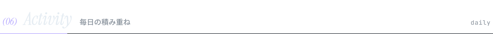</a>

<a href="assets/activity-light.svg#gh-light-mode-only">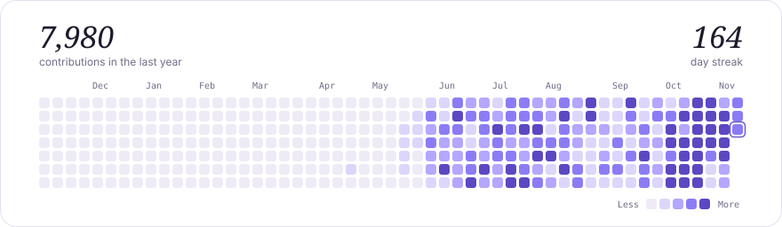</a><a href="assets/activity-dark.svg#gh-dark-mode-only">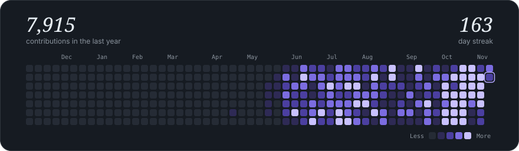</a>

<!-- recent:start -->
- <samp>11/02</samp>　**[KASANE](https://github.com/Maaa2005/KASANE)** — ci: pnpm/action-setup をコミットの指紋で固定する (#4)
- <samp>11/02</samp>　**[local-rag-agent](https://github.com/Maaa2005/local-rag-agent)** — chore(backend): PyJWT と python-multipart を既知の穴が塞がった版へ上げる (#…
- <samp>11/02</samp>　**[Stellise](https://github.com/Maaa2005/Stellise)** — docs(privacy): list the API server, Google Maps and OpenWea…
- <samp>10/23</samp>　**[aun-protocol](https://github.com/Maaa2005/aun-protocol)** — Add agent card checks (aun-card/1)
<!-- recent:end -->

活動の表と最近の更新は、毎朝 GitHub Actions で自動で書き換えています。

<a href="assets/sections/stack-light.png#gh-light-mode-only">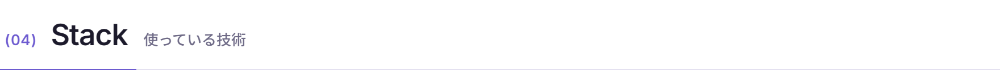</a><a href="assets/sections/stack-dark.png#gh-dark-mode-only">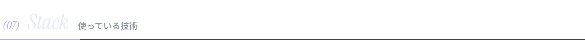</a>

<a href="assets/stack-light.png#gh-light-mode-only">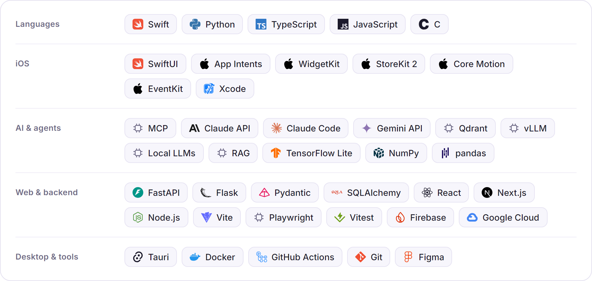</a><a href="assets/stack-dark.png#gh-dark-mode-only">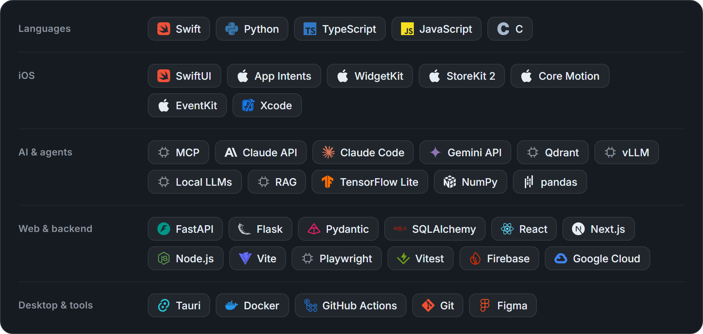</a>

**28卒の採用・インターンのご連絡を歓迎します。**

English

**I want to fuse with AI — so it hears what I hear, remembers what I know, and acts on my behalf.**

Student engineer in Nagoya, Japan · class of 2028. I build the pieces: iOS apps that capture real-world context, and tools that let AI agents act on it safely.

- **Shipped on the App Store:** Stellise (an alarm app where AI suggests your morning tasks; team of two, I did planning and the SwiftUI front end) · Voice Context (turns in-person conversations into context your AI agents can read; I built it, a teammate handles the App Store release).
- **On GitHub:** Web Capability Compiler · AUN Protocol · KASANE (`kasane-cli` on npm) · local-rag-agent (team prototype).
- JDLA G検定 · Google AI Professional Certificate · Tongali Idea Pitch Contest, Runner-up Prize (2025).

Open to internships and 2028 new-grad roles.

