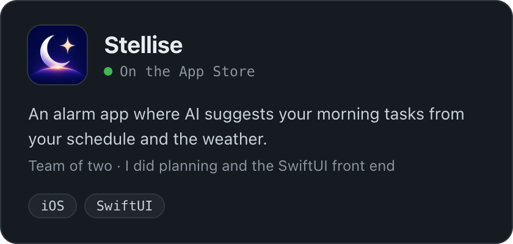
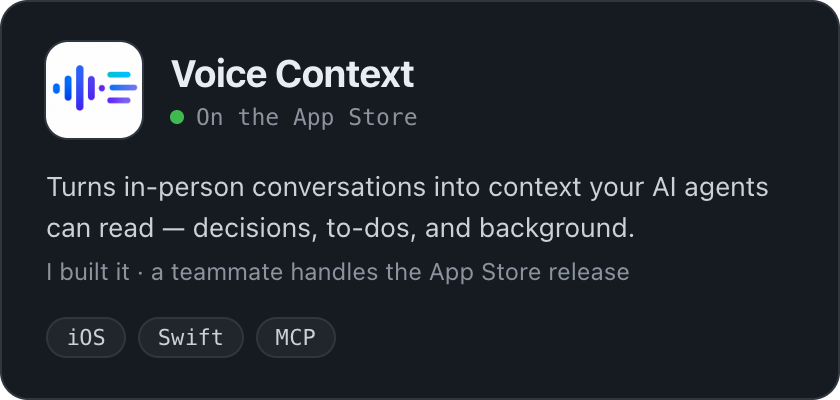
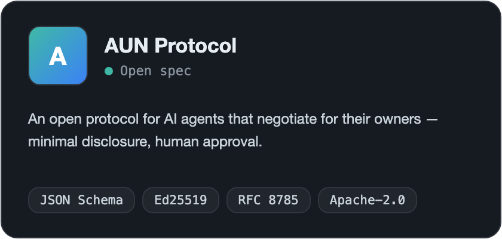
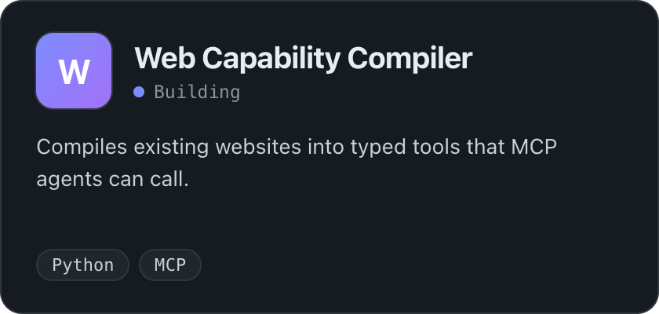
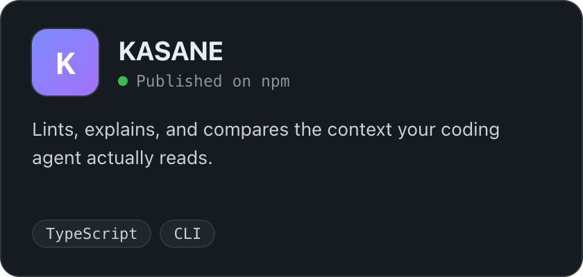
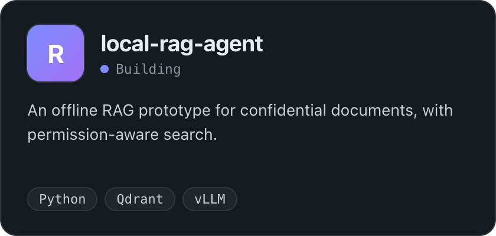
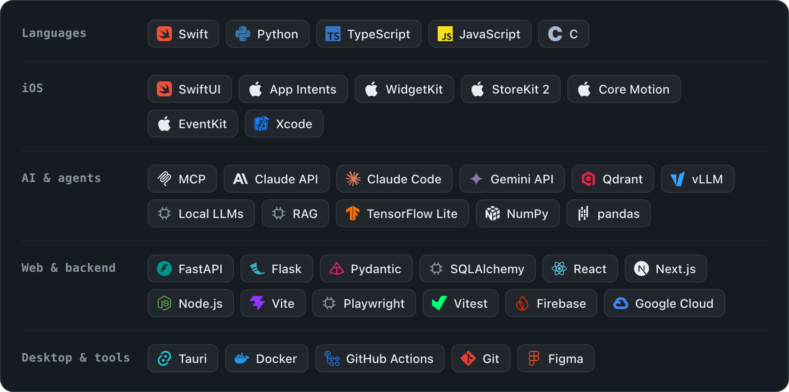

**I want to fuse with AI — so it hears what I hear, remembers what I know, and acts on my behalf.**

Student engineer in Nagoya, Japan · class of 2028.
I build the pieces: apps that capture real-world context, and tools that let AI agents act on it.

日本語

**AIと融合したい。** 聞いたことを一緒に聞き、知っていることを覚えていて、代わりに動いてくれるように。

名古屋の学生エンジニア（2028年卒）。そのための部品をつくっています。身の回りの文脈を拾うアプリと、それを使ってAIエージェントが動くための道具です。

インターン・28卒採用のご連絡を歓迎します。

### Shipped

### Building

### Stack

**Open to** internships and 2028 new-grad roles.

JDLA G検定 · Google AI Professional Certificate · Tongali Idea Pitch Contest, Runner-up Prize (2025)
