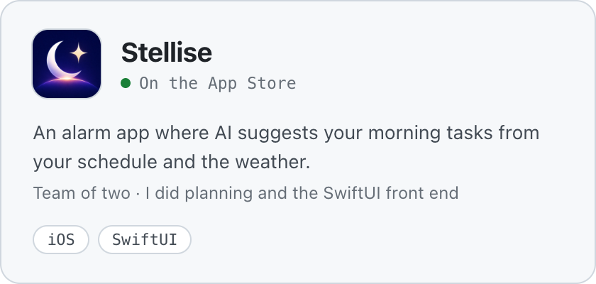
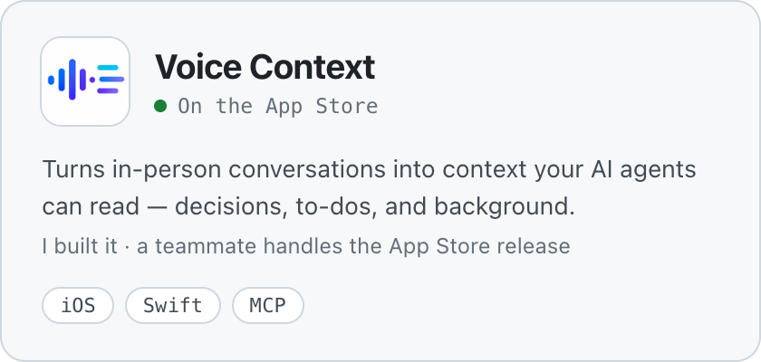
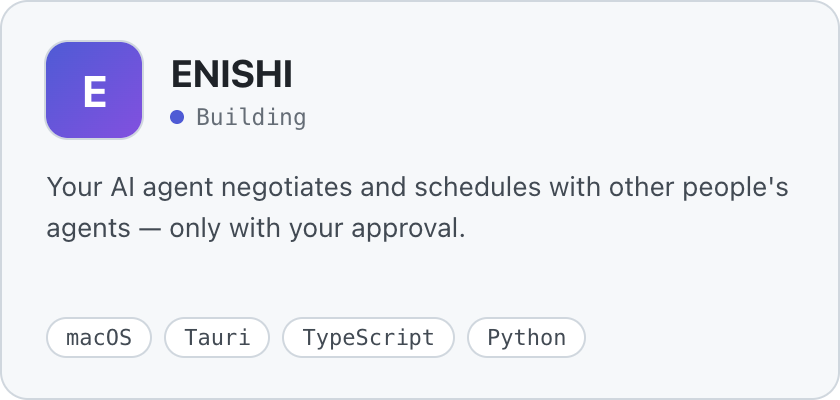
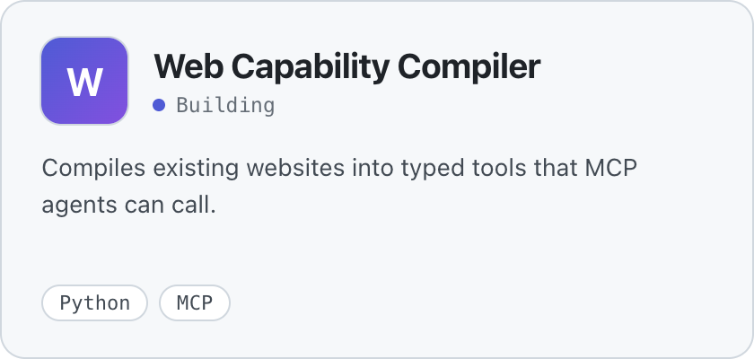
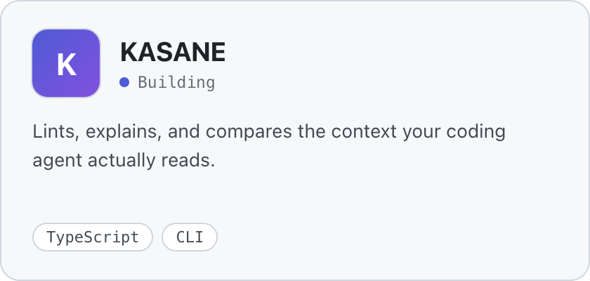
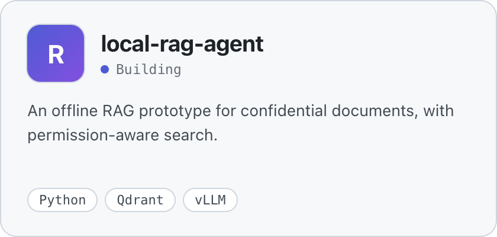
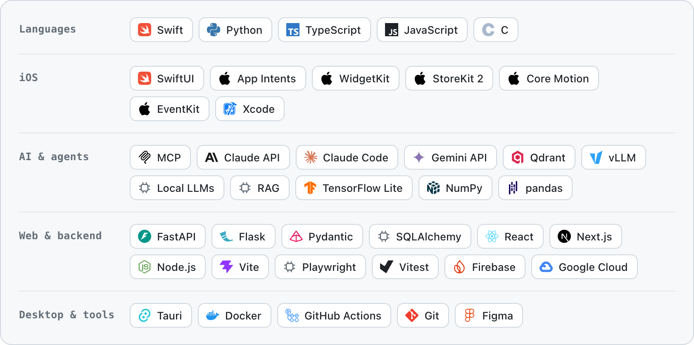

<picture>
  <source media="(prefers-color-scheme: dark)" srcset="assets/header-dark.svg">
  
</picture>

**I want to fuse with AI — so it hears what I hear, remembers what I know, and acts on my behalf.**

Student engineer in Nagoya, Japan · class of 2028.
I build the pieces: apps that capture real-world context, and tools that let AI agents act on it.

### Shipped

<a href="https://apps.apple.com/jp/app/id6760934295"><picture><source media="(prefers-color-scheme: dark)" srcset="assets/cards/stellise-dark.png"></picture></a>
<a href="https://apps.apple.com/jp/app/voice-context/id6804673846"><picture><source media="(prefers-color-scheme: dark)" srcset="assets/cards/voice-context-dark.png"></picture></a>

### Building

<a href="https://github.com/Maaa2005/ENISHI"><picture><source media="(prefers-color-scheme: dark)" srcset="assets/cards/enishi-dark.png"></picture></a>
<a href="https://github.com/Maaa2005/web-capability-compiler"><picture><source media="(prefers-color-scheme: dark)" srcset="assets/cards/wcc-dark.png"></picture></a>

<a href="https://github.com/Maaa2005/KASANE"><picture><source media="(prefers-color-scheme: dark)" srcset="assets/cards/kasane-dark.png"></picture></a>
<a href="https://github.com/Maaa2005/local-rag-agent"><picture><source media="(prefers-color-scheme: dark)" srcset="assets/cards/local-rag-agent-dark.png"></picture></a>

### Stack

<picture>
  <source media="(prefers-color-scheme: dark)" srcset="assets/stack-dark.png">
  
</picture>

**Open to** internships and 2028 new-grad roles.

JDLA G検定 · Google AI Professional Certificate · Tongali Idea Pitch Contest, Runner-up Prize (2025)
