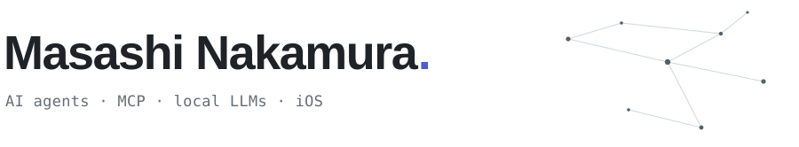

<picture>
  <source media="(prefers-color-scheme: dark)" srcset="assets/header-dark.svg">
  
</picture>

Student engineer in Nagoya, Japan · class of 2028.
I build tools that let AI agents do real work — talk to each other, use the web, and read the right context.

**Building**

- **[ENISHI](https://github.com/Maaa2005/ENISHI)** — your AI agent negotiates and schedules with other people's agents, only with your approval.
- **[Web Capability Compiler](https://github.com/Maaa2005/web-capability-compiler)** — compiles existing websites into typed tools for MCP agents.
- **[KASANE](https://github.com/Maaa2005/KASANE)** — lints, explains, and compares the context your coding agent actually reads.
- **[local-rag-agent](https://github.com/Maaa2005/local-rag-agent)** — an offline RAG prototype for confidential documents, with permission-aware search.

**Shipped**

- **[Stellise](https://apps.apple.com/jp/app/id6760934295)** — an iOS app where AI suggests your morning tasks from your schedule and the weather. Built by a two-person team in about four months; I did product planning and the SwiftUI front end.

**Now** — exploring how agents remember, coordinate, and act on your behalf. Open to internships and 2028 new-grad roles.

JDLA G検定 · Google AI Professional Certificate · Tongali Idea Pitch Contest, Runner-up Prize (2025)
