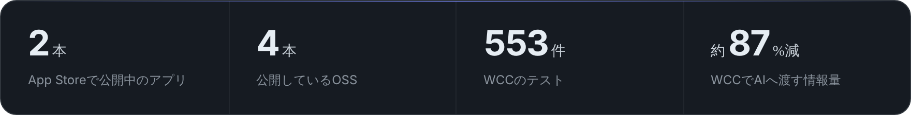
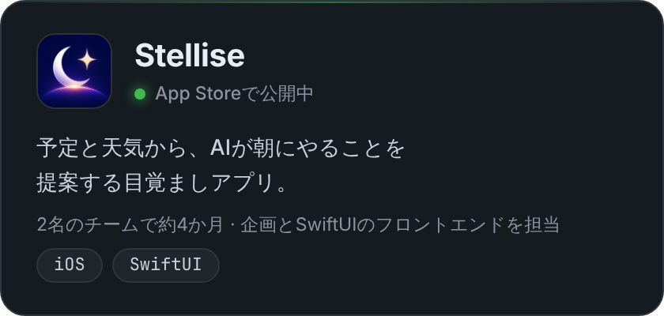
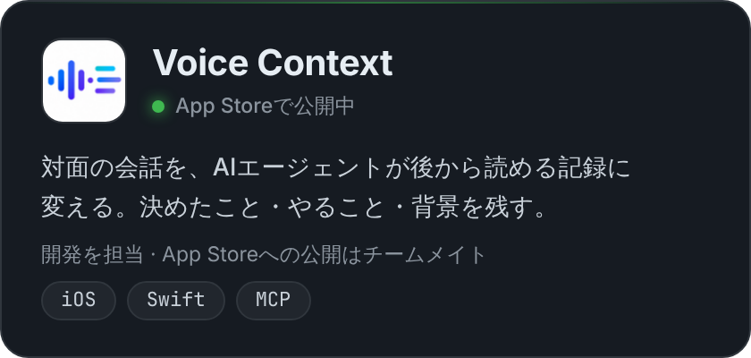
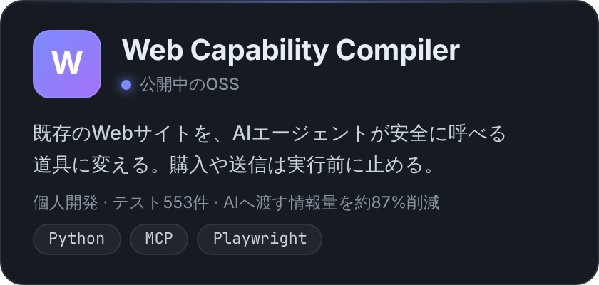
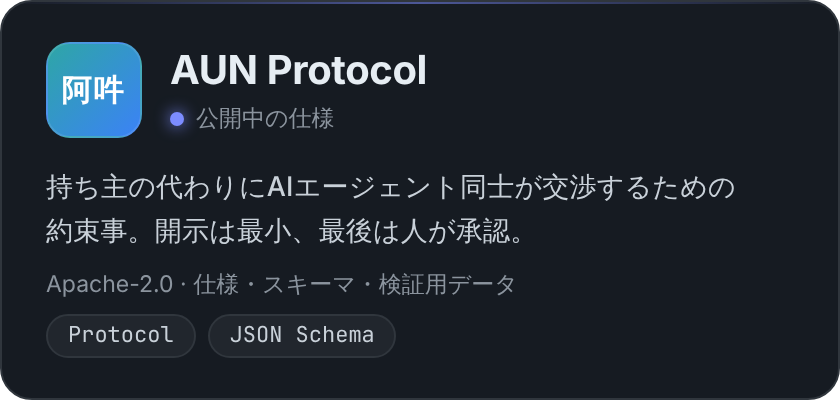
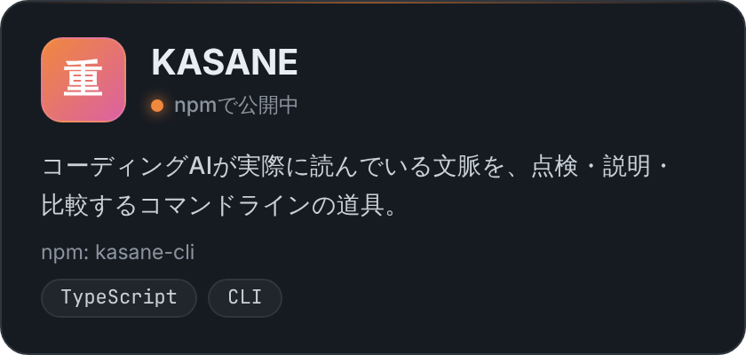
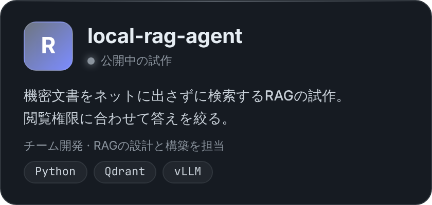
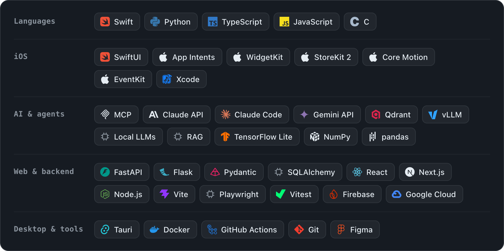

<samp>
<a href="https://apps.apple.com/jp/app/id6760934295">Stellise</a> ·
<a href="https://apps.apple.com/jp/app/voice-context/id6804673846">Voice Context</a> ·
<a href="https://github.com/Maaa2005/web-capability-compiler">WCC</a> ·
<a href="https://github.com/Maaa2005/aun-protocol">AUN</a> ·
<a href="https://www.npmjs.com/package/kasane-cli">KASANE</a> ·
<a href="https://x.com/llmcat17371">X</a>
</samp>

**AIと融合したい。** 聞いたことを一緒に聞き、知っていることを覚えていて、代わりに動いてくれるように。

名古屋の学生エンジニアです（2028年卒）。そのための部品として、身の回りの文脈を拾う **iOSアプリ** と、AIエージェントが安全に動くための **道具** を作っています。

### App Storeで公開中

### 公開しているOSS

### 大事にしていること

- **作って、届ける。** 企画から公開まで運びきる。Stellise は2名のチームで約4か月かけて App Store に出しました。
- **動いたあとに、目的を測る。** テストが通っても終わりにしない。WCC では553件のテストが通ったあとに、AIへ渡す情報量が膨らんでいるのを計測で見つけ、約87%減らしました。
- **AIに任せる範囲は、仕組みで守る。** 購入や送信は実行前に止める（WCC）。交渉の最後は人が承認する（AUN Protocol）。

### 歩み

- <samp>2026.10</samp>　AUN Protocol を仕様として公開 ・ WCC の比較計測（27回）を公開
- <samp>2026.09</samp>　技育博2026 に Stellise を出展 ・ Voice Context を App Store で公開
- <samp>2026.07</samp>　KASANE を npm で公開
- <samp>2026.05</samp>　G検定 ・ Google AI Professional Certificate
- <samp>2025.10</samp>　Tongali アイデアピッチコンテスト 準優秀賞

### 最近の更新

<!-- recent:start -->
- <samp>11/02</samp>　**[Stellise](https://github.com/Maaa2005/Stellise)** — docs(privacy): list the API server, Google Maps and OpenWea…
- <samp>10/27</samp>　**[local-rag-agent](https://github.com/Maaa2005/local-rag-agent)** — ci: backend の単体テストを PR と main で回す
- <samp>10/23</samp>　**[KASANE](https://github.com/Maaa2005/KASANE)** — Release 0.3.1
- <samp>10/23</samp>　**[aun-protocol](https://github.com/Maaa2005/aun-protocol)** — Add agent card checks (aun-card/1)
<!-- recent:end -->

毎朝、公開しているリポジトリから自動で書き換えています。

### 使っている技術

**28卒の採用・インターンのご連絡を歓迎します。**

English

**I want to fuse with AI — so it hears what I hear, remembers what I know, and acts on my behalf.**

Student engineer in Nagoya, Japan · class of 2028. I build the pieces: iOS apps that capture real-world context, and tools that let AI agents act on it safely.

- **Shipped on the App Store:** Stellise (an alarm app where AI suggests your morning tasks; team of two, I did planning and the SwiftUI front end) · Voice Context (turns in-person conversations into context your AI agents can read).
- **Open source:** Web Capability Compiler · AUN Protocol · KASANE (`kasane-cli` on npm) · local-rag-agent.
- JDLA G検定 · Google AI Professional Certificate · Tongali Idea Pitch Contest, Runner-up Prize (2025).

Open to internships and 2028 new-grad roles.

